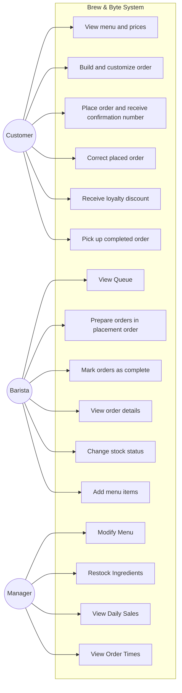

# Use Cases — Group 2
### ICS372 | Fall 2026
**Members:** Thomas, Elijah, Abenezer, Ray
**Last updated:** 9/16/2026 — Fixed Use Case Diagram

---

## 1 · The Use Case Diagram

---

## 2 · All Use Cases

### Customer

- **UC-C1 View menu and prices** — The customers looks at available menu items and how much they cost | req 2.1

- **UC-C2 Build and Customize Order** — The customer can add items, customize those items, remove/add them, order multiple, and add notes | req 2.1, 2.2, 2.3, 2.4, 2.6

- **UC-C3 Place Order and receive confirmation number** — The customer places the order and receives a confirmation number | req 2.5

- **UC-C4 Correct Placed Order** — The customer can fix their order after placing it |  req 2.7

- **UC-C5 Receive Loyalty Discount** — After signing up for the loyalty program they can receive discounts |  req 2.8

- **UC-C6 Pick up completed order** — The customer picks up their order when it is marked ready by the barista |  inferred req 3.3

### Barista

- **UC-B1 View Queue** — The barista views orders that need to be done |  req 3.1

- **UC-B2 Prepare Orders in placement order** — The barista prepares orders in the order they were placed by the customers  |  req 3.2

- **UC-B3 Mark Orders as Complete** — The barista marks orders complete when it is ready to be picked up |  req 3.3

- **UC-B4 View Order Details** — The barista views details, customizations, and notes about the order |  req 3.5

- **UC-B5 Change Stock Status** — The barista can tell the system if something is unavailable |  req 3.6

- **UC-B6 Add Menu Items** — The barista will be able to add menu items when a manager is not present |  req 3.7

### Manager

- **UC-M1 Modify Menu** — The manager will be able to add menu items, configure things like prices and remove items |  req 4.1, 4.2

- **UC-M2 Restock Ingredients** — The manager updates ingredient availablity when supply comes in |  req 4.3

- **UC-M3 View Daily Sales** — The manager can view what was sold and how much revenue was made |  req 4.5

- **UC-M4 View Order Times** — The manager can view how long orders are taking |  req 4.6

---

## 3 · Detailed Use Cases

### UC-C2 Build and Customize Order

**Actor:** Customer

**Precondition:** System must be ready to accept orders

**Postcondition:** Order must go to employee to make it

**Main flow**

| Actor Action | System Response |
|---|---|
| 1. Customer starts order| |
| | 2. Creates a updatable temporary order and tracks stock |
| 3. Customer updates the order | |
| | 4. continues to keep track |
| 5. customer pays for order | |
| | 6. order sent to queue for employees |

**Alternative flows**

**A1 At step 3 — item in menu becomes unavailable **

| Actor Action | System Response |
|---|---|
| 3a. Must select a different item | |
| | 3b. update order and not use out-of-stock item |

Rejoins step 3

**A2 At step 5 — payment failure**

| Actor Action | System Response |
|---|---|
| | 5a. does not send the order to the queue. Ask again for payment |

Can be the end of the process or be sent depending on payment acceptance

**Assumptions:** N/A

---
### UC-C3 Place Order and Receive Confirmation Number - Similar to class UC1

**Actor:** Customer

**Precondition:** The customer is viewing the menu and is ready to place an order. The order queue is ready to receive orders.

**Postcondition:** The order is submitted to the barista queue and the customer receives a confirmation number

**Main flow**

| Actor Action | System Response |
|---|---|
| 1. Customer starts order| |
| | 2. The system shows available items, prices, and availability |
| 3. Customer selects an item from the menu | |
| | 4. The System shows the item's available options and price |
| 5. Customer selects the quantity and desired options | |
| | 6. The system adds the item to the order and shows the updated order |
| 7. Customer reviews the order and makes any necessary changes | |
| | 8. The system shows the updated order and total price |
| 9. Customer places the order | |
| | 10. The system submits the order to the barista queue and provides a confirmation number to the customer |

**Alternative flows**

**A1 At step 5 — Selected item becomes unavailable **

| Actor Action | System Response |
|---|---|
| 5a. Customer selects an item that is no longer available | |
| | 5b. The system informs the customer that the item is unavailable |
| 5c. Customer selects another available item | |

Rejoins step 3

**A2 At step 9 — Customer decides to change the order **

| Actor Action | System Response |
|---|---|
| 9a. Customer decides that the order needs to be changed before placing it | |
| | 9b. The system keeps the order available to changes |

Rejoins step 7

Assumptions: Payment process is undecided and is not included
---

### UC-1: Place an Order - Class Ver

**Actor:** Customer

**Precondition:** The customer has built an order with at least one item, and has chosen a size and customizations for every item.

**Postcondition:** The order is in the barista queue with a confirmation number, and every item on it carries the price it was placed at.

| Actor Action | System Response |
|---|---|
| **1.** Customer asks to place the order. | |
| | **2.** System confirms that every item on the order can be sold right now. |
| | **3.** System works out the price of each item as configured, and records that price on the order. |
| | **4.** If the customer is a loyalty member, system applies the loyalty discount. |
| | **5.** System records the order's total. |
| | **6.** System gives the order a confirmation number. |
| | **7.** System adds the order to the end of the barista queue. |
| | **8.** System shows the customer the confirmation number and the total. |

**Alternative flow 2a: An item can no longer be sold.**

| Actor Action | System Response |
|---|---|
| | **2a1.** System tells the customer which item can no longer be sold. |
| **2a2.** Customer removes that item or changes it to one that can be sold. | |

*Rejoins the main flow at step 1.*

---

---
### UC-2: Complete an Order - Class Ver

**Actor:** Barista

**Precondition:** At least one order is in the barista queue.

**Postcondition:** The oldest order is complete, its ingredients have been used up, and the customer's confirmation number has been called.

| Actor Action | System Response |
|---|---|
| **1.** Barista asks for the next order. | |
| | **2.** System shows the oldest order in the queue: every item, its size, its customizations, and the order's note. |
| **3.** Barista makes the order and marks it complete. | |
| | **4.** System marks the order complete, with the time it was completed. |
| | **5.** System uses up the ingredients for every item on the order, including the ingredients its customizations add. |
| | **6.** System removes the order from the queue. |
| | **7.** System calls the customer's confirmation number. |

**Alternative flow 5a: An ingredient falls below its low-stock level.**

| Actor Action | System Response |
|---|---|
| | **5a1.** System warns the manager which ingredient is running low. |

*Rejoins the main flow at step 6.*
---

### UC-B3 Mark Orders as Complete - Similar to class UC-2

**Actor:** Barista

**Precondition:** The barista has at least one order in the queue that needs to be prepared

**Postcondition:** The order is marked complete and ready for pickup

**Main flow**

| Actor Action | System Response |
|---|---|
| 1. Barista selects an order from the queue| |
| 2. Barista views the order details | |
| 3. Barista prepares the order | |
| 4. Barista marks the order as complete | |
| | 5. The system registers the order as complete |
| | 6. The system marks the order as ready for pickup |

**Alternative flows**

**A1 At step 1 — No orders are currently available **

| Actor Action | System Response |
|---|---|
| 1a. Barista checks the order queue | |
| | 1b. The system shows that there are no orders currently needing completion |
| 1c. Barista waits for an order to become available | |

Assumptions: Orders cannot be changed once it has been placed (requirement 3.4)

---
### UC-3: View the Day's Sales - Class Ver

**Actor:** Manager

**Precondition:** A manager is using the system.

**Postcondition:** The manager has seen how many of each menu item sold today, and how much money came in.

| Actor Action | System Response |
|---|---|
| **1.** Manager asks for today's sales. | |
| | **2.** System finds every order completed today. |
| | **3.** System counts how many of each menu item sold today. |
| | **4.** System adds up the money taken today. |
| | **5.** System shows the manager each menu item with how many sold, and the day's total. |

**Alternative flow 2a: No orders were completed today.**

| Actor Action | System Response |
|---|---|
| | **2a1.** System notes that no orders have been completed today, so every menu item has sold zero and the day's total is zero. |

*Rejoins the main flow at step 5.*

---

### UC-4: Mark an Ingredient Out - Class Ver

**Actor:** Barista

**Precondition:** A barista is using the system.

**Postcondition:** The ingredient is marked out, and nothing that needs it is offered to customers.

| Actor Action | System Response |
|---|---|
| **1.** Barista picks an ingredient and marks it out. | |
| | **2.** System records that the ingredient is out. |
| | **3.** System stops offering every menu item that needs the ingredient, and every customization that uses it. |
| | **4.** System shows the barista what is no longer offered. |

    

## 4 · Non-Functional Requirements

| # | Requirement | What kind | How we would know we met it |
|---|---|---|---|
| 1.2 | The system should be fast and easy to use without extensive training required | Usability/Performance | The response needed from the system and specific training requirements would need to be informed |
| 1.3 | Information should never be lost and be usable or recoverable after a power outage | Reliability | The system should be able to preserve information and restore any of it when needed, but exact recovery requirements are unclear |
| 1.4 | A recently placed order should appear on a barista's tablet immediately | Performance | The delay between order placed and appearing on the tablet needs to be defined |

---

## 5 · Coverage Against the Domain Model

| Use case | Entities it needs | Covered? |
|---|---|---|
| UC-C1 View Menu and Prices | MenuItem | Yes |
| UC-C2 Build and Customize Order | Order, OrderItem, MenuItem | Yes |
| UC-C3 Place Order and Receive Confirmation Number | Order | Yes |
| UC-C4 Correct Placed Order | Order, OrderItem | Yes |
| UC-C5 Receive Loyalty Discount | Customer, Order | Yes |
| UC-C6 Pick Up Completed Order | Order | Yes |
| UC-B1 View Queue | Order, OrderItem | Yes |
| UC-B2 Prepare Order in Placement Order | Order | Yes |
| UC-B3 Mark Orders as Complete | Order | Yes |
| UC-B4 View Order Details | Order, OrderItem, MenuItem | Yes |
| UC-B5 Change Stock Status | MenuItem, Ingredients | Yes |
| UC-B6 Add Menu Items | MenuItem | Yes |
| UC-M1 Modify Menu | MenuItem | Yes |
| UC-M2 Restock Ingredients | Ingredients | Yes |
| UC-M3 View Daily Sales | Order | Yes |
| UC-M4 View Order Times | Order | Yes |

