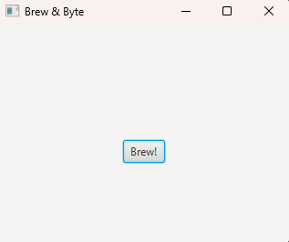

# Group Artifact - Week 12
**Group:** 2
**Members present:** Elijah Allotey, Thomas Yang, Abenezer Aregay, Houreratou Bande
**Date:** 11/12/2026

---

## 1. Tonight's Prompt

## Checklist

Read this aloud in your room and check every box before you commit. **14 of tonight's 20 group points.** The other 6 are in the second handout, after the break.

- [X] Step 1 has one row for every method or field the search finds that knows anything about loyalty members or discounts, or says `none` **(3 pts)**
- [X] Step 2: an interface in `model` for the pricing rule, one class that implements it for loyalty members and one for everyone else; `Order` is handed its rule and totals itself without asking whether anyone is a member; no class but the loyalty rule's knows what the discount is **(5 pts)**
- [X] Step 3: `LoyaltyPricingTest` has both test methods, and step 3 has the last line of `./gradlew test` **(2 pts)**
- [X] Sections 2 to 4 of the template say how you got here, where you disagreed, and what you're not sure about **(4 pts)**
- [X] Committed: `docs/week-12/group-artifact.md` and everything in `src/` **(required: nothing is graded without it)**

---

The case paid for keeping its rule in three places. Now do requirement 2.8 in **your own code**, the better way.

- **2.8** Loyalty members get their discount automatically. They shouldn't have to ask.

Copy the steps below into **section 1 of your group artifact** and put each deliverable under the step that asked for it.

**Running commands.** Commands in this handout run in IntelliJ's terminal (**View > Tool Windows > Terminal**), which starts in your project folder. They're written the Mac way. On Windows in PowerShell, IntelliJ's default, type `.\gradlew` where this says `./gradlew`; in Command Prompt, type `gradlew`. Windows has no `grep`: use IntelliJ's **Find in Files** instead, as step 1 says.

**Before step 1: does it compile?** Run `./gradlew compileJava` from your project folder. If it fails, fixing it is your group's first job tonight, before anything else in this handout. Read the **first** error, not the last. If `module-info.java` has a `requires` line for JUnit or any other testing library, a test class is probably sitting under `src/main`. Move every test class to the same package under `src/test/java`, then delete that `requires` line: only the tests use those libraries. Nothing goes under this heading in your artifact; the second handout, after the break, checks the whole build.

**Step 1: Where the rule lives now.** Search your code. On a Mac or Linux, run this from your project folder:

```
grep -rn --include=*.java -i -E "loyal|discount|member" src/main
```

On Windows, or if you'd rather, use IntelliJ: **Edit > Find > Find in Files**. Type `loyal|discount|member`, turn on the regular expression option (the `.*` button), leave **Match case** off, choose **Directory**, and pick your `src/main` folder.

One row for every method the search finds, in a table with exactly these three columns. The example row is from the library and shows only the shape.

| Class and method | What it knows | Changes if the rule changes? |
|---|---|---|
| Customer.Customer | The created customers loyalty code | no |
| Customer.checkLoyalty | If the customer is a member | no |
| Customer (loyaltyStatus) | Stores the customer's loyalty status | no |
| ShopSetup.main() | Creates a customer with "Member" status | Yes |

- **Class and method** is `ClassName.methodName`. A field with no method around it gets a row too: write `ClassName (field)`.
- **Changes if the rule changes?** is `yes` or `no`.
- If the search finds nothing, write `none` under step 1 and move on.

**Step 2: The code.** In `src/main/java/edu/metrostate/oodi/brewandbyte/model/`:

- **The rule.** Use what your group recorded for 2.8 in `docs/design/open-questions.md`. If you recorded nothing, use 10 percent off the order's total, and leave 2.8 open.
- **One interface for the pricing rule.** Name it for what it does. It has one method, and that method answers how much comes off an order.
- **Two classes implement it:** one for loyalty members, and one for everyone else that takes nothing off.
- **`Order` is handed its rule** in its constructor, keeps it in a `private final` field, and uses it when it totals. Nothing in `Order` asks whether the customer is a member.
- **Which class chooses the rule is your call.** Put one sentence in section 2 of the template saying which class chooses it and why that one.
- If your code doesn't know whether a customer is a member yet, give the class that chooses the rule a way to know. A `boolean` is enough tonight.
- Delete any flag, setter or `if` that switched the discount on or off in `Order` or anywhere else. Every row your step 1 table marked `yes` should now be in the loyalty rule's class, or gone.
- If a change stops a test compiling, fix the test.
- Leave the JavaFX files alone until after the break.

**Step 3: The test.** In `src/test/java/edu/metrostate/oodi/brewandbyte/model/LoyaltyPricingTest.java`:

- `memberGetsTheDiscount()`: the setup builds its own menu item and an order with the loyalty rule handed in. The test checks the order's total against the number you work out by hand.
- `everyoneElsePaysFullPrice()`: the same order with the other rule. The test checks that the total is the full price.
- Neither test uses anything `ShopSetup` builds.

Run `./gradlew test`. Under step 3, paste the last line of its output in a code block. If it fails and you're out of time, paste the first error and one sentence on what it means.

BUILD SUCCESSFUL in 1s

Commit and push the artifact and the code together.

## Checklist

Work down this list in order and check every box before you commit. **6 of tonight's 20 group points.**

**Item 1: What the regroup showed (1 pt)**
- [X] Item 1 names each thing the regroup showed that your code did, and what you changed, or says `none`

**Item 2: It compiles and every test passes (2 pts)**
- [X] Everyone in the group has pushed, and the driver has pulled
- [X] `./gradlew test` ends with `BUILD SUCCESSFUL`, with no test deleted or commented out
- [X] Its last line is pasted under item 2

**Item 3: One home for every class (1 pt)**
- [X] Every class under `src/main` is in `model`, `view`, or the package that holds `Launcher`
- [X] Item 3 lists every class you moved or deleted, or says `none`
- [X] `./gradlew test` still ends with `BUILD SUCCESSFUL`

**Item 4: The window (2 pts)**
- [X] (a) `mainClass` names `Launcher`, and `./gradlew run` opens the **Brew!** window
- [ ] (b) `ShopSetup` has a method that builds the menu, and `ShopSetup.main` uses it
- [ ] (c) `brew-and-byte.fxml` holds the menu list
- [ ] (d) `BrewAndByteController` fills the list from the menu
- [ ] (e) `BrewAndByteApplication` builds the menu and hands it to the controller
- [X] `./gradlew run` opens a window listing every item on your menu with its price
- [X] The screenshot is committed at `docs/week-12/first-screen.png` and shows in the artifact
- [ ] Item 4 names everyone in the group who has opened the window on their own computer

**Committed (required: nothing is graded without it)**
- [X] Everything new is under `### After the regroup`, committed and pushed with your code and the screenshot

---

## How to Run Things

**One person drives.** The driver shares their screen and types; everyone else reads along, catches mistakes and looks things up. Switch drivers between items if you like. At the end, everyone pulls and runs the window on their own computer (the last box of item 4).

**Where commands go.** Open the terminal inside IntelliJ: **View > Tool Windows > Terminal**. It starts in your project folder, the one with `gradlew` in it. Every command in this handout runs from there.

**How to type a command.** This handout writes commands the Mac way. Use the line for your computer:

| Your computer | Run the tests | Run the application |
|---|---|---|
| Mac or Linux | `./gradlew test` | `./gradlew run` |
| Windows, PowerShell (IntelliJ's default) | `.\gradlew test` | `.\gradlew run` |
| Windows, Command Prompt | `gradlew test` | `gradlew run` |

**No terminal, or no `gradlew.bat` in your repo?** Use IntelliJ's Gradle window instead: **View > Tool Windows > Gradle**, then open **Tasks**. Double-click **verification > test** to run the tests, or **application > run** to run the application.

**The first run is slow.** Gradle downloads itself, Java 25 and JavaFX the first time, which can take several minutes. Let it finish. The runs after that take seconds.

**Three ways to start the application.** Any one is fine.

1. In the terminal: `./gradlew run`
2. In the Gradle window: **Tasks > application > run**
3. In IntelliJ: open `Launcher.java` and click the green arrow beside `main`. **Run `Launcher`, never `BrewAndByteApplication`.**

On a Mac, the window can open behind IntelliJ. If nothing seems to happen, look for a Java icon in the Dock.

---

Don't start a new file or delete your first version's work. Put everything new under this heading at the very end of section 1:

### After the regroup

**Item 1: What the regroup showed.** One bullet for each thing the regroup showed that your code did, and what you changed. If nothing applied, write `none`. Keep this short.

none

**Item 2: It compiles and every test passes.** Everyone pushes what they have, then the driver runs `git pull`. Then:

```
./gradlew test
```

It compiles everything under `src/main` and `src/test` and runs every test. Fix every error until it ends with `BUILD SUCCESSFUL`. Under item 2, paste the last line of its output in a code block.

- Read the **first** error, not the last. Later errors are usually caused by the first one.
- A test that fails because the test is out of date gets fixed. A test that fails because the code is wrong means the code gets fixed.
- Don't delete a test or comment one out to make the build pass.
- If `module-info.java` has a `requires` line for JUnit or any other testing library, a test class is probably sitting under `src/main`. Move every test class to the same package under `src/test/java`, then delete that `requires` line. Only the tests use those libraries, and the line stops the application from running.

BUILD SUCCESSFUL in 623ms

**Item 3: One home for every class.** From next week the application is built in three places: `model`, `view`, and the package that holds `Launcher` and the JavaFX files. Look at every class under `src/main`:

- A class in any other package moves into one of those three. In IntelliJ, drag the file onto the package in the Project window and let it fix the `package` line and the imports.
- A class nothing uses, and that isn't in `docs/design/class-model.md`, gets deleted.
- Under item 3, one bullet for each class you moved or deleted, saying which and where to, or write `none`. Run `./gradlew test` again when you're done.

none

**Item 4: The window.** Your repo has had a JavaFX application in it since Week 1: `Launcher` starts it, `BrewAndByteApplication` opens the window, `brew-and-byte.fxml` says what's in the window, and `BrewAndByteController` fills it in. Tonight it shows your menu. Do these in order, and run the application after each one that says to.

**(a) Make it run.** In `build.gradle.kts`, find the line that sets `mainClass` and change it to exactly this:

```kotlin
    mainClass.set("edu.metrostate.oodi.brewandbyte.Launcher")
```

If IntelliJ shows a small elephant icon offering to reload Gradle, click it. Run the application. A small window with a **Brew!** button should open. Close it. **Don't go on until this works;** the table at the end of this handout covers the usual problems.

**(b) A method that builds the menu.** In `ShopSetup`, add a `public static` method that builds your menu, every item and its price, the way `ShopSetup` builds it now, and returns it. Change `ShopSetup.main` to get its menu from that method, so the menu is built in one place. Use your own class's name if your menu isn't called `Menu`.

**(c) The FXML file.** Replace everything in `src/main/resources/edu/metrostate/oodi/brewandbyte/brew-and-byte.fxml` with this:

```xml
<?xml version="1.0" encoding="UTF-8"?>

<?import javafx.geometry.Insets?>
<?import javafx.scene.control.Label?>
<?import javafx.scene.control.ListView?>
<?import javafx.scene.layout.VBox?>

<VBox spacing="10.0" xmlns:fx="http://javafx.com/fxml"
      fx:controller="edu.metrostate.oodi.brewandbyte.BrewAndByteController">
  <padding>
    <Insets bottom="20.0" left="20.0" right="20.0" top="20.0"/>
  </padding>

  <Label text="Menu"/>
  <ListView fx:id="menuList" prefHeight="500.0"/>
</VBox>
```

**(d) The controller.** In `BrewAndByteController`, delete the `welcomeText` field and the `onBrewButtonClick` method. Add a field for the list, and one method that fills it from your menu, one line per item: its name, then its price. Here is the shape, from the library, not from your code:

```java
public class CatalogController {
    @FXML
    private ListView<String> bookList;

    public void showBooks(Catalog catalog) {
        for (Book book : catalog) {
            bookList.getItems().add(book.getTitle() + "    " + book.getCallNumber());
        }
    }
}
```

Your field is named `menuList`, matching `fx:id` in the FXML. Get the items from your menu however your menu hands them out (Week 10 decided that). Format a `double` price with `String.format("$%.2f", price)`; a `BigDecimal` price can go straight in with `"$" + price`. Your IDE will offer the imports, including `javafx.scene.control.ListView`.

**(e) The application.** Replace the `start` method in `BrewAndByteApplication` with this, changing `Menu` and `buildMenu` to your names, and import both `ShopSetup` and your menu class from `model`:

```java
    @Override
    public void start(Stage stage) throws IOException {
        Menu menu = ShopSetup.buildMenu();
        FXMLLoader fxmlLoader = new FXMLLoader(BrewAndByteApplication.class.getResource("brew-and-byte.fxml"));
        Scene scene = new Scene(fxmlLoader.load(), 480, 640);
        BrewAndByteController controller = fxmlLoader.getController();
        controller.showMenu(menu);
        stage.setTitle("Brew & Byte");
        stage.setScene(scene);
        stage.show();
    }
```

Run `./gradlew run`. The window lists your menu.

- Leave the console screens in `view` alone. They become windows next week.
- Don't move the JavaFX files into another package tonight.

**The screenshot.** Save a screenshot of the running window as `docs/week-12/first-screen.png` and put this line under item 4: ``

**Last: everyone runs it.** Commit and push the artifact, the screenshot and the code together. Then everyone in the group runs `git pull` and starts the application on their own computer. The driver lists the names of everyone whose window opened under item 4, then commits and pushes once more. Anyone whose window didn't open puts the first line of their error in section 4 of the template.



---

## If It Doesn't Run

Find the first error in the output, then find it here.

| What you see | What it means | What to do |
|---|---|---|
| `Could not find or load main class` or `Main class ... not found`, naming `CoffeeShopApplication` | `build.gradle.kts` names a class that doesn't exist | Step (a) |
| `JavaFX runtime components are missing` | You started `BrewAndByteApplication` directly | Start `Launcher`, or use `./gradlew run` |
| `module not found: org.junit.jupiter.api`, or any other testing library | `module-info.java` requires a library only the tests have, usually because a test class is under `src/main` | Move every test class to `src/test/java`, then delete that `requires` line |
| `zsh: permission denied: ./gradlew` (Mac) | The script isn't marked runnable | Run `chmod +x gradlew` once, then try again |
| `'gradlew' is not recognized` or `.\gradlew : The term ... is not recognized` (Windows) | You're not in the project folder, or the repo has no `gradlew.bat` | Open IntelliJ's terminal, which starts in the right folder. If there's still no `gradlew.bat`, use the Gradle window. |
| `invalid source release: 25` or `Unsupported class file major version` in IntelliJ | IntelliJ is running Gradle with an older Java | **Settings > Build, Execution, Deployment > Build Tools > Gradle**, set **Gradle JVM** to a Java 25, then reload Gradle. If there's none, use `./gradlew` in the terminal, which downloads its own. |
| `Location is not set` | The FXML file wasn't found | The file must be exactly `src/main/resources/edu/metrostate/oodi/brewandbyte/brew-and-byte.fxml` |
| `Error resolving onAction='#onBrewButtonClick'` | The FXML still points at the method you deleted | Replace the whole FXML file with the one in step (c) |
| `ClassNotFoundException` naming the controller | `fx:controller` in the FXML doesn't match the controller's full name | It must be exactly `edu.metrostate.oodi.brewandbyte.BrewAndByteController` |
| `NullPointerException` in `showMenu` on `menuList` | The field isn't connected to the FXML | The field's name must match `fx:id="menuList"` exactly, with `@FXML` on the line above it |
| `cannot find symbol` naming `ShopSetup`, `Menu` or `ListView` | A missing import | Click the red name and let IntelliJ add the import |
| The window opens and the list is empty | Nothing reached the list | Check that `buildMenu` returns a menu with items in it, and that `start` calls `showMenu` |
| Nothing happens, no error (Mac) | The window opened behind IntelliJ | Look for a Java icon in the Dock |

**Stuck for ten minutes on the same error?** Paste its first line in the main room's chat with your group number.


---

## 2. How We Got Here

We first examined our code to see where the loyalty membership was being checked and if discount logic was already implemented. We found that Customer stored the customer's loyalty status and used checkLoyalty() to determine if they were a member or not. We also saw that ShopSetup created a customer with Member status.

While thinking how to implement the discount calculation we decided to use the Strategy Pattern so things would be handled separately from Order. We made a DiscountHandler interface and created two implementations. LoyaltyDiscount for members and RegularDiscount for everyone else. The loyalty implementation calculates 10% off and the regular implementation returns no discount.

Adding these caused us to update our Order class to receive DiscountHandler through its constructor and use that handler when calculating the total. This allowed Order to no longer need to check whether a customer is a member or decide which discount applies.

Lastly we chose ShopSetup to select the appropriate discount handler because it already creates the customer and can check their loyalty status. During this we updated existing test and created the LoyaltyPricingTest.

---

## 3. Where We Disagreed

Our group agreed to the overall design and the DiscountHandler interface. The only varying opinion was how to organize the discount implementations. With one option being a single and the other being splitting the discounts into separate classes.

---

## 4. What We're Not Sure About

We aren't sure how the system should handle multiple discounts at the same time. If a customer were to qualify for a seasonal and a loyalty discount, would one take priority or would they combine.

Another thing is if the correct discount handler will always be assigned when an order is created. Currently, ShopSetup checks for the loyalty status and if that selection is incorrect a loyalty member could end up paying full.


